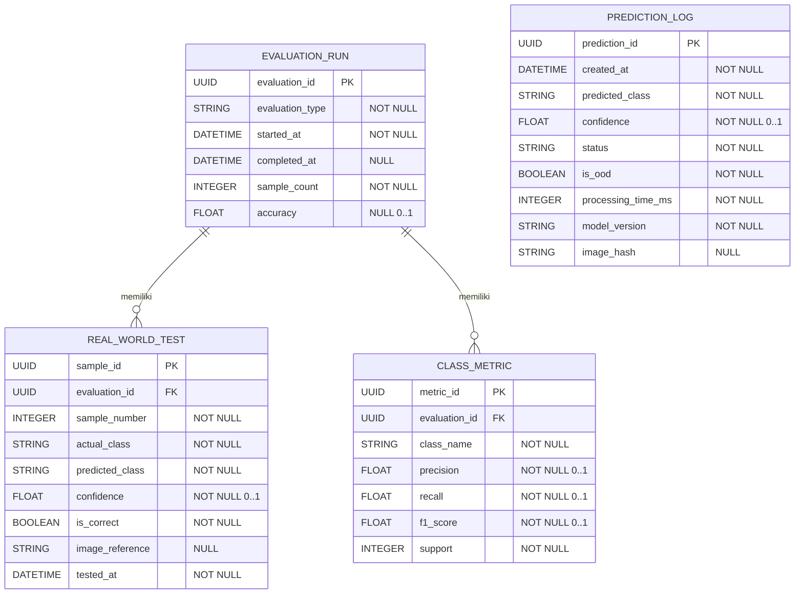

# ERD AgriScan AI

## Index dan constraint penting

- `prediction_log`: PK `prediction_id`; index `created_at`, `predicted_class`, `image_hash`.
- `evaluation_run`: PK `evaluation_id`; index `evaluation_type`.
- `real_world_test`: PK `sample_id`; FK `evaluation_id`; unique `(evaluation_id, sample_number)`.
- `class_metric`: PK `metric_id`; FK `evaluation_id`; unique `(evaluation_id, class_name)`.
- Confidence dan metric bernilai 0–1.
- Accuracy bernilai 0–1.
- `sample_number >= 1`.
- Real-world evaluation minimal 60 sampel divalidasi pada application/service layer.
- Enam kelas: Cabai Normal, Cabai Antraknosa, Cabai Leaf Curl, Tomat Normal, Tomat Early Blight, Tomat Late Blight.

# [ASUMSI-03]
`image_reference` hanya menyimpan path/URL sementara; kebijakan retensi file belum ditentukan.
