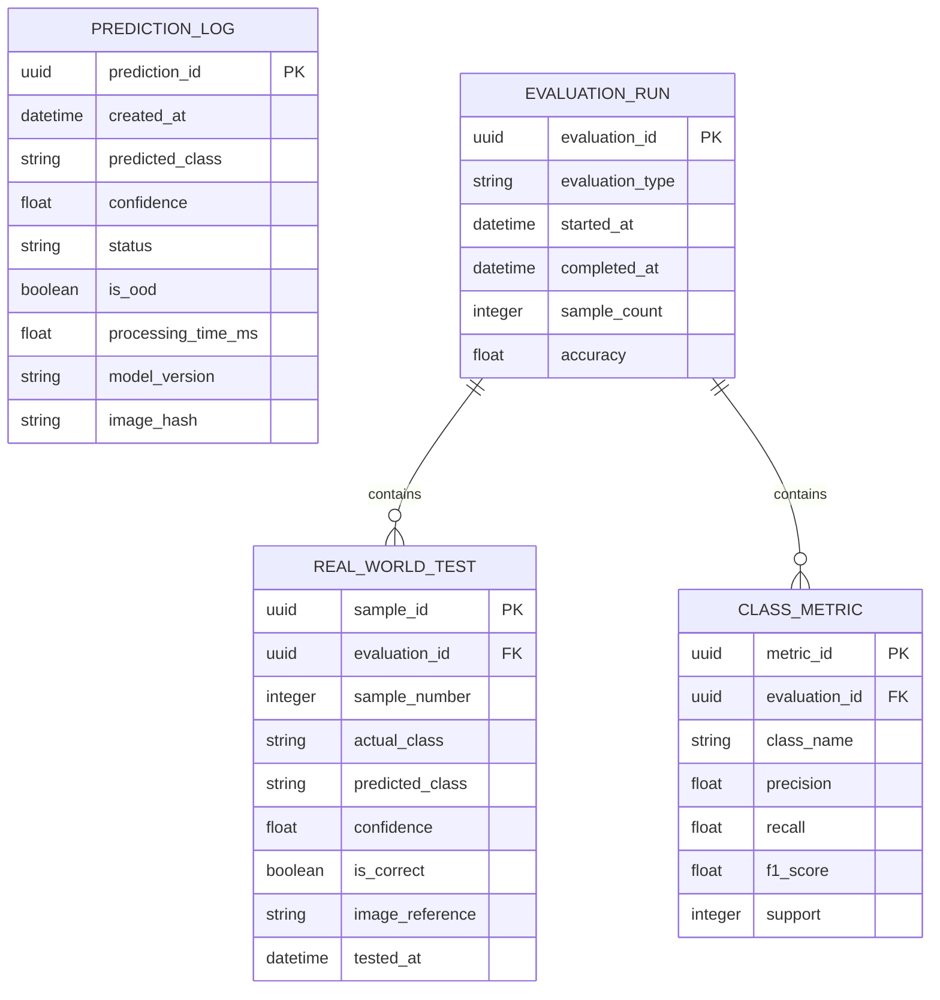
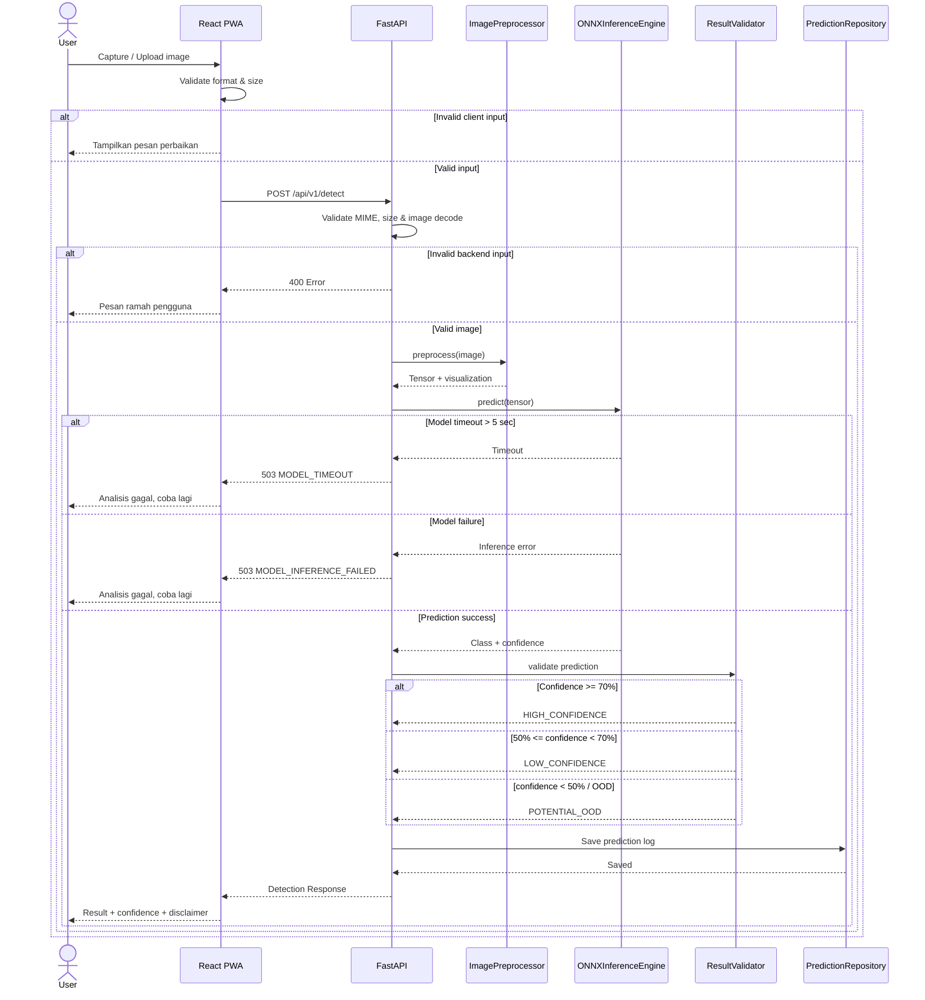

# DRAF LOW-LEVEL DESIGN (LLD)

## AgriScan AI — Fitur Must Have & AI Inference

**Platform:** PWA Mobile-friendly
**Frontend:** React + Vite + Tailwind CSS
**Backend:** Python FastAPI
**AI:** CNN + ONNX Runtime CPU
**Database:** SQLite/PostgreSQL + SQLAlchemy ORM
**Architecture:** Clean Architecture / Layered Architecture
**Scope:** Prototype 3 bulan, 1 fitur AI inti

> **Catatan desain:** FR-07 dan FR-08 berstatus *Should Have* pada SRS, tetapi karena HLD dan permintaan API secara eksplisit memasukkan Low Confidence/OOD, mekanisme threshold tersebut tetap dirancang pada layer postprocessing. Tidak ada fitur baru di luar requirement yang ditambahkan.

---

# 1. DESAIN MODUL / CLASS

## 1.1 Struktur Modul

Struktur high-level source code yang diusulkan:

```text
agrisc an-ai/
├── frontend/
│   └── src/
│       ├── components/
│       ├── pages/
│       ├── services/
│       └── types/
│
└── backend/
    └── app/
        ├── presentation/
        │   ├── api/
        │   │   └── detect_router.py
        │   └── schemas/
        │       └── detection_schema.py
        │
        ├── application/
        │   ├── services/
        │   │   └── image_analysis_service.py
        │   └── use_cases/
        │       └── detect_image.py
        │
        ├── domain/
        │   ├── entities/
        │   │   ├── detection_result.py
        │   │   └── preprocessing_result.py
        │   └── interfaces/
        │       ├── inference_engine.py
        │       └── prediction_repository.py
        │
        └── infrastructure/
            ├── ai/
            │   ├── onnx_inference_engine.py
            │   └── preprocessing_engine.py
            ├── database/
            │   ├── models/
            │   └── repositories/
            └── storage/
```

Alur dependensi:

```text
Presentation
     ↓
Application
     ↓
Domain
     ↑
Infrastructure
```

Domain tidak bergantung langsung pada FastAPI, SQLAlchemy, atau ONNX Runtime.

---

# 1.2 Modul `ImageAnalysisService`

### Tanggung jawab

`ImageAnalysisService` menjadi orchestrator utama proses deteksi:

1. menerima image;
2. memvalidasi input;
3. memanggil preprocessing;
4. memanggil ONNX inference;
5. melakukan postprocessing;
6. menghasilkan `DetectionResult`;
7. meminta penyimpanan prediction log.

### Atribut kunci

| Atribut                 | Tipe                       | Keterangan              |
| ----------------------- | -------------------------- | ----------------------- |
| `preprocessor`          | `ImagePreprocessor`        | Komponen preprocessing  |
| `inference_engine`      | `InferenceEngine`          | Interface inference CNN |
| `result_validator`      | `DetectionResultValidator` | Validasi confidence/OOD |
| `prediction_repository` | `PredictionRepository`     | Penyimpanan log         |

### Method utama

```python
analyze(
    image_bytes: bytes,
    filename: str,
    mime_type: str
) -> DetectionResult
```

### Alur

```text
ImageAnalysisService
        │
        ├── validate input
        │
        ├── preprocess()
        │
        ├── infer()
        │
        ├── validate prediction
        │
        ├── create DetectionResult
        │
        └── save prediction log
```

**Keputusan:** orchestration diletakkan pada application layer agar router FastAPI tidak mengandung business logic.

**Alternatif:** seluruh proses ditempatkan di FastAPI router. Lebih cepat untuk prototype sangat kecil, tetapi menyulitkan testing dan mempertahankan Clean Architecture.

---

# 1.3 Modul `ImagePreprocessor`

### Tanggung jawab

Mengubah citra input menjadi format yang dapat digunakan CNN dan menghasilkan representasi visual preprocessing untuk memenuhi FR-06.

### Atribut

| Atribut                | Tipe               |
| ---------------------- | ------------------ |
| `target_width`         | `int`              |
| `target_height`        | `int`              |
| `normalization_config` | `dict[str, float]` |
| `supported_formats`    | `set[str]`         |

Nilai `target_width`, `target_height`, dan parameter normalisasi harus mengikuti model CNN yang sebenarnya.

**[KEPUTUSAN TIM: tentukan ukuran input CNN dan parameter normalisasi berdasarkan model final.]**

### Method

```python
validate(
    image_bytes: bytes,
    mime_type: str,
    file_size: int
) -> bool
```

```python
preprocess(
    image_bytes: bytes
) -> PreprocessingResult
```

```python
create_visualization(
    image: ImageData
) -> bytes
```

`PreprocessingResult`:

```python
class PreprocessingResult:
    original_image: bytes
    processed_tensor: Tensor
    visualization: bytes
```

### Opsi library preprocessing

| Opsi       | Kelebihan                                 | Kekurangan              |
| ---------- | ----------------------------------------- | ----------------------- |
| **OpenCV** | Cepat, ringan, umum untuk computer vision | API lebih teknis        |
| **Pillow** | Sederhana dan mudah digunakan             | Fitur CV lebih terbatas |

**[KEPUTUSAN TIM: OpenCV / Pillow]**

**Kriteria:** pilih berdasarkan library yang digunakan ketika training CNN. Preprocessing inference harus menghasilkan transformasi yang konsisten dengan preprocessing saat training.

---

# 1.4 Modul `InferenceEngine`

Interface domain/application:

```python
class InferenceEngine:
    def predict(
        self,
        input_tensor: Tensor
    ) -> ModelPrediction:
        ...
```

Implementasi infrastructure:

```python
class ONNXInferenceEngine(InferenceEngine):
    ...
```

### Atribut

| Atribut           | Tipe               |
| ----------------- | ------------------ |
| `model_path`      | `str`              |
| `session`         | `InferenceSession` |
| `class_labels`    | `list[str]`        |
| `timeout_seconds` | `float`            |

`timeout_seconds`:

```text
5.0 detik
```

sesuai skenario timeout yang diminta.

### Output

```python
class ModelPrediction:
    predicted_class: str
    confidence: float
    class_probabilities: dict[str, float]
```

---

# 1.5 Modul `DetectionResult`

Entity domain utama.

### Atribut

| Field                     | Tipe              |
| ------------------------- | ----------------- |
| `prediction_id`           | `UUID`            |
| `predicted_class`         | `str`             |
| `confidence`              | `float`           |
| `status`                  | `DetectionStatus` |
| `ood`                     | `bool`            |
| `preprocessing_available` | `bool`            |
| `disclaimer`              | `str`             |

### Status

```text
HIGH_CONFIDENCE
LOW_CONFIDENCE
POTENTIAL_OOD
```

### Method

```python
is_high_confidence() -> bool
```

```python
is_low_confidence() -> bool
```

```python
is_potential_ood() -> bool
```

```python
to_response() -> DetectionResponse
```

---

# 1.6 `DetectionResultValidator`

Modul ini menangani postprocessing.

```python
validate(
    predicted_class: str,
    confidence: float,
    is_out_of_domain: bool
) -> DetectionStatus
```

Logika:

```text
IF out_of_domain == true
    → POTENTIAL_OOD

ELSE IF confidence < 0.50
    → POTENTIAL_OOD

ELSE IF confidence < 0.70
    → LOW_CONFIDENCE

ELSE
    → HIGH_CONFIDENCE
```

Sehingga:

| Confidence | Status            |
| ---------: | ----------------- |
|    `≥ 70%` | `HIGH_CONFIDENCE` |
| `50%–<70%` | `LOW_CONFIDENCE`  |
|     `<50%` | `POTENTIAL_OOD`   |

**Catatan:** OOD karena `out_of_domain` membutuhkan mekanisme pendeteksian domain yang belum ditentukan secara teknis dalam SRS.

### Opsi OOD

| Opsi                           | Deskripsi                                                   | Kompleksitas |
| ------------------------------ | ----------------------------------------------------------- | ------------ |
| **A — Confidence threshold**   | Confidence `<50%` dianggap potential OOD                    | Rendah       |
| **B — Dedicated OOD detector** | Model/metode tambahan untuk mendeteksi input di luar domain | Tinggi       |

**[KEPUTUSAN TIM: gunakan Opsi A / Opsi B]**

**Rekomendasi desain prototype:** Opsi A karena SRS sudah menetapkan confidence threshold dan prototype hanya memiliki satu fitur AI inti. Jika Opsi B dipilih, dataset/metode OOD tambahan harus ditetapkan oleh tim.

---

# 1.7 Repository Prediction

Interface:

```python
class PredictionRepository:
    def save(
        self,
        prediction: DetectionResult
    ) -> str:
        ...
```

Implementasi:

```python
class SQLAlchemyPredictionRepository(PredictionRepository):
    ...
```

Tujuannya memisahkan business logic dari database.

---

# 2. SKEMA DATA

## 2.1 Entity Relationship Diagram



---

# 2.2 Tabel `prediction_log`

Mencatat hasil inference aplikasi.

| Field                | Type         | Constraint    |
| -------------------- | ------------ | ------------- |
| `prediction_id`      | UUID         | PK            |
| `created_at`         | DateTime     | NOT NULL      |
| `predicted_class`    | VARCHAR(50)  | NOT NULL      |
| `confidence`         | FLOAT        | NOT NULL, 0–1 |
| `status`             | VARCHAR(30)  | NOT NULL      |
| `is_ood`             | BOOLEAN      | NOT NULL      |
| `processing_time_ms` | INTEGER      | NOT NULL      |
| `model_version`      | VARCHAR(50)  | NOT NULL      |
| `image_hash`         | VARCHAR(128) | NULL          |

Constraint:

```text
confidence >= 0 AND confidence <= 1
```

`image_hash` digunakan sebagai identifier teknis tanpa harus menyimpan raw image pada prediction log.

---

# 2.3 Tabel `evaluation_run`

Digunakan untuk mengelompokkan satu aktivitas evaluasi.

| Field             | Type        | Constraint |
| ----------------- | ----------- | ---------- |
| `evaluation_id`   | UUID        | PK         |
| `evaluation_type` | VARCHAR(30) | NOT NULL   |
| `started_at`      | DateTime    | NOT NULL   |
| `completed_at`    | DateTime    | NULL       |
| `sample_count`    | INTEGER     | NOT NULL   |
| `accuracy`        | FLOAT       | NULL       |

Untuk real-world test:

```text
evaluation_type = REAL_WORLD
sample_count >= 60
```

**Catatan:** constraint `>=60` dapat diberlakukan pada application-level karena SQL constraint lintas record tidak diperlukan untuk prototype.

---

# 2.4 Tabel `real_world_test`

Menyimpan metadata minimal untuk setiap sampel real-world.

| Field             | Type         | Constraint |
| ----------------- | ------------ | ---------- |
| `sample_id`       | UUID         | PK         |
| `evaluation_id`   | UUID         | FK         |
| `sample_number`   | INTEGER      | NOT NULL   |
| `actual_class`    | VARCHAR(50)  | NOT NULL   |
| `predicted_class` | VARCHAR(50)  | NOT NULL   |
| `confidence`      | FLOAT        | NOT NULL   |
| `is_correct`      | BOOLEAN      | NOT NULL   |
| `image_reference` | VARCHAR(255) | NULL       |
| `tested_at`       | DateTime     | NOT NULL   |

Foreign key:

```text
real_world_test.evaluation_id
        ↓
evaluation_run.evaluation_id
```

`sample_number` dapat diberi constraint unik dalam satu evaluation run.

---

# 2.5 Tabel `class_metric`

Menyimpan Precision, Recall, dan F1 untuk masing-masing dari enam kelas.

| Field           | Type        | Constraint |
| --------------- | ----------- | ---------- |
| `metric_id`     | UUID        | PK         |
| `evaluation_id` | UUID        | FK         |
| `class_name`    | VARCHAR(50) | NOT NULL   |
| `precision`     | FLOAT       | NOT NULL   |
| `recall`        | FLOAT       | NOT NULL   |
| `f1_score`      | FLOAT       | NOT NULL   |
| `support`       | INTEGER     | NOT NULL   |

Constraint:

```text
0 <= precision <= 1
0 <= recall <= 1
0 <= f1_score <= 1
support >= 0
```

Unique:

```text
UNIQUE(evaluation_id, class_name)
```

---

# 2.6 Enam Nilai `class_name` yang Valid

```text
Cabai Normal
Cabai Antraknosa
Cabai Leaf Curl
Tomat Normal
Tomat Early Blight
Tomat Late Blight
```

**[KEPUTUSAN TIM: implementasikan pembatasan enam kelas menggunakan database CHECK constraint atau validasi application/domain.]**

Untuk SQLite/PostgreSQL, validasi domain/application tetap diperlukan agar aturan tidak hanya bergantung pada database.

---

# 3. SPESIFIKASI API DETAIL

# `POST /api/v1/detect`

## 3.1 Method

```http
POST /api/v1/detect
```

## 3.2 Headers

```http
Content-Type: multipart/form-data
Accept: application/json
Authorization: Bearer <token>
```

`Authorization` hanya diterapkan jika authentication diaktifkan.

**[KEPUTUSAN TIM: Authentication enabled / disabled untuk prototype.]**

HTTPS wajib digunakan pada deployment.

---

# 3.3 Request Body

```text
multipart/form-data
```

Field:

| Field   | Type | Required | Constraint   |
| ------- | ---- | -------- | ------------ |
| `image` | File | Ya       | JPG/JPEG/PNG |
| `image` | File | Ya       | ≤ 5 MB       |

Contoh:

```text
image = leaf_photo.jpg
```

Tidak menggunakan Base64 karena multipart upload lebih efisien untuk file gambar.

---

# 3.4 Response Normal — High Confidence

Input:

```text
Confidence = 0.86
```

Response:

```http
200 OK
```

```json
{
  "success": true,
  "data": {
    "prediction": {
      "class": "Cabai Antraknosa",
      "confidence": 0.86,
      "confidence_percent": 86.0,
      "status": "HIGH_CONFIDENCE",
      "ood": false
    },
    "preprocessing": {
      "available": true,
      "visualization": true
    },
    "disclaimer": "Hasil AI merupakan indikasi awal, bukan diagnosis definitif dari pakar."
  }
}
```

---

# 3.5 Response Low Confidence

Input:

```text
Confidence = 0.63
```

Response:

```http
200 OK
```

```json
{
  "success": true,
  "data": {
    "prediction": {
      "class": "Tomat Early Blight",
      "confidence": 0.63,
      "confidence_percent": 63.0,
      "status": "LOW_CONFIDENCE",
      "ood": false
    },
    "warning": {
      "code": "LOW_CONFIDENCE",
      "message": "Hasil belum cukup meyakinkan. Silakan coba ambil gambar kembali dengan pencahayaan dan fokus yang lebih baik."
    },
    "preprocessing": {
      "available": true,
      "visualization": true
    },
    "disclaimer": "Hasil AI merupakan indikasi awal, bukan diagnosis definitif dari pakar."
  }
}
```

---

# 3.6 Response Potential OOD

Input:

```text
Confidence = 0.42
```

Response:

```http
200 OK
```

```json
{
  "success": true,
  "data": {
    "prediction": {
      "class": "Tomat Late Blight",
      "confidence": 0.42,
      "confidence_percent": 42.0,
      "status": "POTENTIAL_OOD",
      "ood": true
    },
    "warning": {
      "code": "OOD_DETECTED",
      "message": "Gambar belum dapat dikenali dengan cukup yakin oleh sistem. Silakan gunakan gambar tanaman cabai atau tomat dengan objek terlihat jelas."
    },
    "preprocessing": {
      "available": true,
      "visualization": true
    },
    "disclaimer": "Hasil AI merupakan indikasi awal, bukan diagnosis definitif dari pakar."
  }
}
```

> Walaupun model menghasilkan `class`, frontend menggunakan `status = POTENTIAL_OOD` sebagai status utama dan tidak menyajikannya sebagai hasil yang meyakinkan.

---

# 3.7 Daftar HTTP Error

| HTTP | Internal Code               | Kondisi                                  |
| ---: | --------------------------- | ---------------------------------------- |
|  400 | `INVALID_IMAGE_FORMAT`      | Format bukan JPG/JPEG/PNG                |
|  400 | `IMAGE_TOO_LARGE`           | Ukuran >5 MB                             |
|  400 | `INVALID_IMAGE_DATA`        | File tidak dapat didecode sebagai gambar |
|  408 | `MODEL_TIMEOUT`             | Inference >5 detik                       |
|  422 | `INVALID_REQUEST`           | Request multipart tidak valid            |
|  429 | `RATE_LIMIT_EXCEEDED`       | Melebihi rate limit                      |
|  500 | `PREPROCESSING_FAILED`      | Preprocessing gagal                      |
|  503 | `MODEL_UNAVAILABLE`         | Model/service tidak tersedia             |
|  503 | `MODEL_INFERENCE_FAILED`    | Model gagal melakukan inference          |
|  500 | `PREDICTION_STORAGE_FAILED` | Logging gagal                            |

### Contoh error

```json
{
  "success": false,
  "error": {
    "code": "IMAGE_TOO_LARGE",
    "message": "Ukuran gambar terlalu besar. Silakan gunakan gambar maksimal 5 MB."
  }
}
```

---

# 4. SEQUENCE DIAGRAM



---

# 4.1 Detail Timeout

Timeout ditetapkan:

```text
MODEL_TIMEOUT = 5 detik
```

Alur:

```text
API
 ↓
ONNX Inference
 ↓
Timer > 5 detik?
 ├── No → lanjutkan
 └── Yes → cancel/fail inference
              ↓
        HTTP 503
        MODEL_TIMEOUT
```

Sistem **tidak boleh** mengembalikan prediksi jika inference timeout.

---

# 4.2 Logging Async

HLD menyebut logging async.

Secara konseptual:

```text
Inference
   ↓
Result
   ├──────────────→ Client Response
   │
   └──→ Async Prediction Logging
```

**[KEPUTUSAN TIM: gunakan `BackgroundTasks` FastAPI atau message queue untuk asynchronous logging.]**

### Opsi

| Opsi                      | Kelebihan                         | Kekurangan                       |
| ------------------------- | --------------------------------- | -------------------------------- |
| FastAPI `BackgroundTasks` | Sangat sederhana, cocok prototype | Tidak ideal untuk workload besar |
| Message Queue             | Lebih reliable dan scalable       | Menambah service/infrastruktur   |

**Kriteria:** untuk prototype 3 bulan dan biaya minimal, pilih mekanisme yang tidak membutuhkan service tambahan.

---

# 5. ERROR HANDLING & FALLBACK

## 5.1 Prinsip

Error dibagi menjadi:

```text
Client Error
      ↓
Validation Error
      ↓
Processing Error
      ↓
AI Error
      ↓
Infrastructure Error
```

Setiap error memiliki:

1. internal error code;
2. HTTP status;
3. pesan teknis untuk log;
4. pesan sederhana untuk pengguna.

---

# 5.2 Retry Strategy

Tidak semua error boleh di-retry.

| Error                    | Retry            |
| ------------------------ | ---------------- |
| `INVALID_IMAGE_FORMAT`   | Tidak            |
| `IMAGE_TOO_LARGE`        | Tidak            |
| `INVALID_IMAGE_DATA`     | Tidak            |
| `PREPROCESSING_FAILED`   | Tidak otomatis   |
| `MODEL_TIMEOUT`          | Maksimal 1 retry |
| `MODEL_UNAVAILABLE`      | Tidak langsung   |
| `MODEL_INFERENCE_FAILED` | Maksimal 1 retry |
| `RATE_LIMIT_EXCEEDED`    | Tidak langsung   |

**Alasan:** retry terhadap image invalid tidak akan memperbaiki input dan hanya membuang resource.

**[KEPUTUSAN TIM: retry model error = 0 atau 1 kali.]**

Untuk prototype, **1 retry maksimum** sudah cukup jika dipilih.

---

# 5.3 Pesan Error Ramah Petani

Pesan internal:

```text
MODEL_INFERENCE_FAILED
```

Jangan ditampilkan langsung kepada pengguna.

Gunakan:

> **"Analisis gambar belum berhasil. Silakan coba kembali dengan gambar yang lebih jelas."**

---

### Image terlalu besar

Internal:

```text
IMAGE_TOO_LARGE
```

User:

> **"Ukuran gambar terlalu besar. Silakan gunakan gambar maksimal 5 MB."**

---

### Format tidak sesuai

Internal:

```text
INVALID_IMAGE_FORMAT
```

User:

> **"Format gambar belum didukung. Silakan gunakan JPG, JPEG, atau PNG."**

---

### Timeout

Internal:

```text
MODEL_TIMEOUT
```

User:

> **"Analisis membutuhkan waktu terlalu lama. Silakan coba kembali."**

---

### Low Confidence

User:

> **"Hasil belum cukup meyakinkan. Silakan ambil foto kembali dengan pencahayaan dan fokus yang lebih baik."**

---

### Potential OOD

User:

> **"Gambar belum dapat dikenali dengan cukup yakin oleh sistem. Silakan gunakan gambar tanaman cabai atau tomat dengan objek terlihat jelas."**

---

# 5.4 Mode Koneksi Lambat

Karena aplikasi ditargetkan untuk penggunaan lapangan dan SRS menyebut koneksi terbatas, client perlu menangani request yang lama.

Alur:

```text
User Upload
     ↓
Upload Progress
     ↓
Request Pending
     ↓
Jika lambat
     ↓
Tampilkan:
"Sedang menganalisis gambar..."
```

Jangan membuat request baru secara otomatis hanya karena koneksi lambat, karena dapat menghasilkan duplicate inference.

---

# 5.5 Mode Offline

Karena inference menggunakan **server-side AI**, inference tidak dapat dilakukan ketika perangkat benar-benar offline.

Fallback:

```text
Offline
  ↓
Tidak kirim inference
  ↓
Tampilkan:
"Koneksi internet diperlukan untuk melakukan analisis AI."
```

PWA tetap dapat menampilkan interface yang sudah tersedia secara lokal, tetapi **tidak melakukan prediksi offline**.

**Alasan:** HLD telah memilih server-side inference dan tidak terdapat requirement untuk model AI offline.

---

# 6. TRACEABILITY LLD → SRS

| LLD Element                | SRS ID              | Implementasi                |
| -------------------------- | ------------------- | --------------------------- |
| `ImageAnalysisService`     | FR-02               | Orchestrator analisis CNN   |
| `ImagePreprocessor`        | FR-06               | Preprocessing + visualisasi |
| `InferenceEngine`          | FR-02               | Interface inference         |
| `ONNXInferenceEngine`      | FR-02               | CNN inference ONNX          |
| `DetectionResult`          | FR-03               | Hasil klasifikasi 6 kelas   |
| `DetectionResult`          | FR-04               | Confidence                  |
| `detect_router`            | FR-01               | Upload/capture melalui API  |
| `POST /api/v1/detect`      | FR-01, FR-02, FR-05 | Endpoint inti               |
| `DetectionResultValidator` | BR-01               | Confidence threshold        |
| `DetectionResultValidator` | BR-02               | OOD validation              |
| Response `disclaimer`      | FR-10, BR-03        | Batas klaim AI              |
| `prediction_log`           | FR-02, FR-04        | Logging hasil inference     |
| `evaluation_run`           | FR-11, FR-12        | Pengelompokan evaluasi      |
| `real_world_test`          | FR-12               | Minimal 60 sampel           |
| `class_metric`             | FR-11               | Precision, Recall, F1       |
| `evaluation_run.accuracy`  | NFR-01              | Target ≥91% dataset         |
| `evaluation_run.accuracy`  | NFR-02              | Target ≥75% real-world      |
| `timeout_seconds`          | NFR-07/08           | Kontrol latency             |
| Image validation           | NFR-07/08           | Pemrosesan input ringan     |
| Confidence field           | FR-04               | 100% prediction result      |
| HTTPS                      | NFR security        | Proteksi komunikasi         |
| EXIF stripping             | Privacy             | Minimalisasi metadata       |
| Rate limiter               | Security            | Pembatasan request          |
| Async logging              | NFR-07/08           | Tidak menghambat response   |

---

# 7. TRACEABILITY DETAIL PER REQUIREMENT

| Requirement                           | Class/Module                             | API                   | Database                            |
| ------------------------------------- | ---------------------------------------- | --------------------- | ----------------------------------- |
| **FR-01** Input image                 | `ImageAnalysisService`, validator        | `POST /api/v1/detect` | —                                   |
| **FR-02** CNN analysis                | `InferenceEngine`, `ONNXInferenceEngine` | `/detect`             | `prediction_log`                    |
| **FR-03** 6-class classification      | `DetectionResult`, `InferenceEngine`     | `/detect`             | `prediction_log`                    |
| **FR-04** Confidence                  | `ModelPrediction`, `DetectionResult`     | `/detect`             | `prediction_log.confidence`         |
| **FR-05** Display result              | Response schema + React                  | `/detect`             | —                                   |
| **FR-06** Preprocessing visualization | `ImagePreprocessor`                      | `/detect`             | —                                   |
| **FR-10** Disclaimer                  | Response schema                          | `/detect`             | —                                   |
| **FR-11** Evaluation metrics          | Evaluation module                        | —                     | `class_metric`                      |
| **FR-12** 60 real-world samples       | Evaluation module                        | —                     | `evaluation_run`, `real_world_test` |
| **NFR-01** ≥91%                       | Evaluation module                        | —                     | `evaluation_run.accuracy`           |
| **NFR-02** ≥75%                       | Evaluation module                        | —                     | `evaluation_run.accuracy`           |
| **NFR-07/08** Latency                 | `InferenceEngine`, timeout handler       | `/detect`             | `processing_time_ms`                |
| **BR-01** Confidence threshold        | `DetectionResultValidator`               | `/detect`             | `prediction_log.status`             |
| **BR-02** OOD                         | `DetectionResultValidator`               | `/detect`             | `prediction_log.is_ood`             |
| **BR-03** Disclaimer                  | `DetectionResult`                        | `/detect`             | —                                   |

---

# 8. Kontrak Internal Antarlayer

Agar Clean Architecture tetap konsisten, dependency utama dapat diringkas sebagai berikut:

```text
┌─────────────────────────────┐
│       Presentation          │
│                             │
│ detect_router               │
│ DetectionResponse           │
└──────────────┬──────────────┘
               ↓
┌─────────────────────────────┐
│        Application          │
│                             │
│ ImageAnalysisService        │
│ DetectImageUseCase          │
└──────────────┬──────────────┘
               ↓
┌─────────────────────────────┐
│           Domain            │
│                             │
│ DetectionResult             │
│ ModelPrediction             │
│ InferenceEngine             │
│ PredictionRepository        │
└──────────────┬──────────────┘
               ↑
┌─────────────────────────────┐
│       Infrastructure        │
│                             │
│ ONNXInferenceEngine         │
│ ImagePreprocessor           │
│ SQLAlchemyRepository        │
└─────────────────────────────┘
```

**Prinsip utama:** `Presentation` tidak boleh langsung memanggil SQLAlchemy atau ONNX Runtime. Semua interaksi melewati application/domain interface.

---

# 9. Keputusan Teknis yang Masih Harus Dikunci Tim

| ID        | Keputusan             | Opsi                                          | Kriteria                                  |
| --------- | --------------------- | --------------------------------------------- | ----------------------------------------- |
| **KD-01** | Library preprocessing | OpenCV / Pillow                               | Konsistensi dengan preprocessing training |
| **KD-02** | OOD                   | Confidence threshold / Dedicated OOD detector | Akurasi OOD vs kompleksitas               |
| **KD-03** | Authentication        | Enabled / Disabled                            | Kebutuhan akses prototype                 |
| **KD-04** | Async logging         | FastAPI BackgroundTasks / Queue               | Beban dan reliability                     |
| **KD-05** | DB prototype          | SQLite / PostgreSQL                           | Concurrency dan deployment                |
| **KD-06** | Retry inference       | 0 / 1 retry                                   | Latency vs reliability                    |
| **KD-07** | CNN input size        | Sesuai model final                            | Harus identik dengan training             |
| **KD-08** | Model versioning      | String version / file metadata                | Kemudahan evaluasi dan rollback           |

### Keputusan minimum yang harus dikunci sebelum coding

**[KEPUTUSAN TIM: KD-01, KD-02, KD-03, KD-04, KD-07]**

Kelima keputusan tersebut memengaruhi kontrak antar-modul atau hasil inference sehingga sebaiknya ditetapkan sebelum implementasi backend.

---

## 10. Ringkasan LLD Final

Implementasi fitur inti mengikuti alur:

```text
React PWA
   │
   │ multipart/form-data
   ▼
POST /api/v1/detect
   │
   ▼
FastAPI Router
   │
   ▼
ImageAnalysisService
   │
   ├── ImagePreprocessor
   │       └── Tensor + preprocessing visualization
   │
   ├── ONNXInferenceEngine
   │       └── 6-class prediction + confidence
   │
   ├── DetectionResultValidator
   │       ├── >=70% → HIGH_CONFIDENCE
   │       ├── 50-<70% → LOW_CONFIDENCE
   │       └── <50% / OOD → POTENTIAL_OOD
   │
   └── PredictionRepository
           └── prediction_log
   │
   ▼
JSON Response
   │
   ▼
React Result + Confidence + Disclaimer
```

Dengan desain ini, **FR-01 sampai FR-06 dan FR-10 sampai FR-12** memiliki jalur implementasi yang jelas, sementara mekanisme **Low Confidence/OOD** dari HLD tetap terisolasi pada `DetectionResultValidator`. Database juga sudah menyediakan struktur untuk **logging prediksi, minimal 60 sampel real-world test, serta Precision/Recall/F1 per enam kelas**, tanpa masuk ke detail implementasi level kode yang seharusnya berada pada tahap coding.
